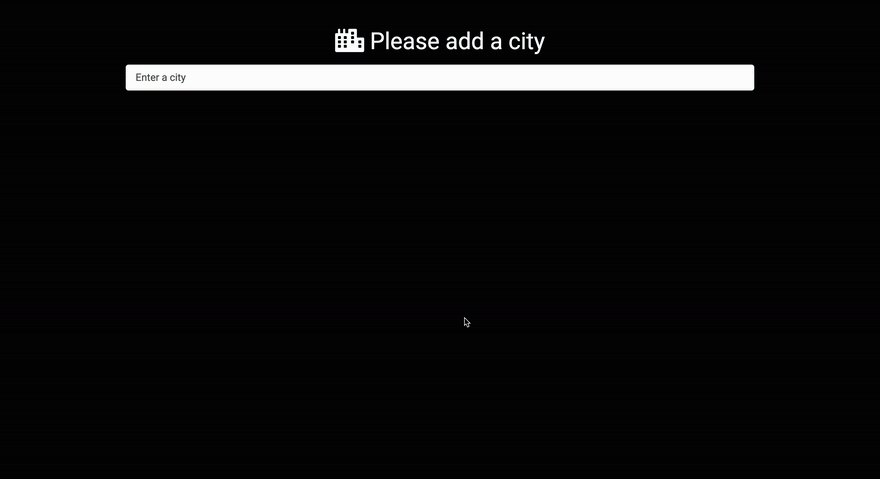

# Smart Weather App

A weather app that tells you what to wear. Search for any city and it shows the current weather and local time, sets the background to match the conditions, and suggests outfits for men and women based on the temperature. No login is needed. Built with Python and Django on the OpenWeather API.



▶️ **[Watch the full demo video](https://sangye-tenphel.s3.amazonaws.com/smartWeatherApp.mp4)** (38 seconds)

## Features

- **City search with suggestions:** as you type, matching cities appear from a list of over 200,000 cities worldwide, shown with their state and country code (for example "New York City NY US").
- **Current weather:** temperature in °F, today's high and low, a description such as "scattered clouds", and the OpenWeather icon.
- **Local day and time:** the city's time zone is looked up from its coordinates, so it shows the city's own time, not yours.
- **Weather backgrounds:** the page background changes for clear skies, clouds, rain, drizzle, snow, thunderstorms and other conditions (fog, mist and so on).
- **Outfit suggestions:** a men's and a women's outfit for each 10°F band, from below 40°F up to 80°F and above.
- **Switch cities anytime** from the **+** button on the weather card.

## How it works

1. The home page loads the city list (`cleaned_city.list.json`) in the browser, and `main.js` filters it as you type.
2. Choosing a city opens `/<city_id>`. The Django view requests that city's current weather from the OpenWeather API in imperial units.
3. The view finds the city's time zone from its coordinates with `timezonefinder`, then gets the local day and time from the WorldTimeAPI.
4. It picks the background image from the weather condition and the outfit images from the temperature, then renders the page.

## Project structure

```
smart_weather_app/        Django project settings and URLs
smart_weather/            The app
├── views.py              Weather lookup, time zone, background and outfit logic
├── urls.py               "/" (city search) and "/<city_id>" (weather page)
├── templates/            index.html (search) and weather.html (results)
└── static/smart_weather/
    ├── main.js           City search and suggestions
    ├── cleaned_city.list.json   The city list used by the search
    ├── styles.css, bootstrap.min.css
    └── images/           Weather backgrounds and outfit photos
clean json/               Script that shrinks OpenWeather's city list
```

### The `clean json` folder

OpenWeather's full city list (`city.list.json`) includes each city's coordinates, which the search doesn't need. `clean.py` removes them and writes `cleaned_city.list.json`, a smaller file for the browser to download.

## Running it locally

The pinned package versions date from 2020, so use **Python 3.8**.

```bash
python3.8 -m venv venv
source venv/bin/activate
pip install -r requirements.txt
python manage.py runserver
```

Then open http://127.0.0.1:8000. The app needs an internet connection, since the weather and time data come from the OpenWeather API and the WorldTimeAPI. To use your own OpenWeather API key, get a free one at [openweathermap.org](https://openweathermap.org/api) and replace the `appid` value in `smart_weather/views.py`.

## Built with

- **Backend:** Python, Django 3, Requests and timezonefinder
- **Frontend:** HTML, CSS, Bootstrap and JavaScript
- **APIs:** [OpenWeather](https://openweathermap.org/) (weather and city list) and [WorldTimeAPI](http://worldtimeapi.org/) (local time)

Created by Sangye Tenphel, 2020.
